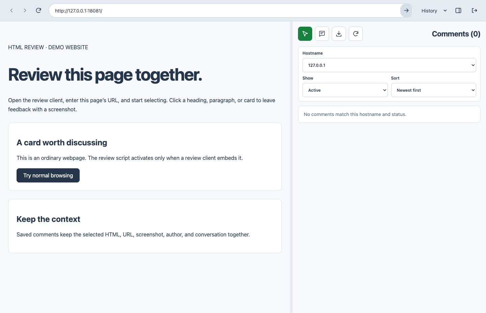

# HTML Review

Review websites with element comments, annotated screenshots, replies, and downloadable HTML reports. This public repository contains desktop releases and illustrated user guides.

[Download the latest release](https://github.com/devtalkbox/tbproducts-html-review-release/releases/latest) · [English user guide](docs/wiki/User-Guide.md) · [繁體中文使用指南](docs/wiki/User-Guide-zh-HK.md) · [Admin console](https://html-review-206149277907.asia-east1.run.app/)

## Download v1.0.1

Downloads are public and do not require a GitHub account. Use the package matching your operating system and processor.

| Platform | Download | Setup |
| --- | --- | --- |
| macOS Apple silicon (M series) | [DMG](https://github.com/devtalkbox/tbproducts-html-review-release/releases/download/v1.0.1/HTML.Review-1.0.1-arm64.dmg) | Open the DMG and drag HTML Review into Applications. |
| macOS Intel | [DMG](https://github.com/devtalkbox/tbproducts-html-review-release/releases/download/v1.0.1/HTML.Review-1.0.1-x64.dmg) | Open the DMG and drag HTML Review into Applications. |
| Windows x64 — portable | [Runnable EXE](https://github.com/devtalkbox/tbproducts-html-review-release/releases/download/v1.0.1/HTML.Review.Portable.1.0.1-x64.exe) | Double-click to run. No installation required. |
| Windows x64 — installer | [Setup EXE](https://github.com/devtalkbox/tbproducts-html-review-release/releases/download/v1.0.1/HTML.Review.Setup.1.0.1-x64.exe) | Run setup, then open HTML Review. |
| Linux x64 | [AppImage](https://github.com/devtalkbox/tbproducts-html-review-release/releases/download/v1.0.1/HTML.Review-1.0.1-x64.AppImage) | Make executable, then run. |

For Linux:

```sh
chmod +x HTML.Review-1.0.1-x64.AppImage
./HTML.Review-1.0.1-x64.AppImage
```

The Windows portable EXE extracts runtime files to a temporary folder when launched. Reviewer sessions and website cookies are stored in your user profile.

## Start reviewing

1. Open HTML Review. Version 1.0.1 connects to `https://html-review-206149277907.asia-east1.run.app/` by default.
2. Enter your display name and the reviewer access code supplied by your administrator, then click **Sign in**.
3. Enter an authorized website URL and click **Open page**.
4. Click **Start selecting**, then click the element you want to discuss.
5. Write your comment, optionally annotate its screenshot, and click **Save comment**.

Use the comment list to read and reply to threads, archive resolved feedback, highlight commented elements, or export an HTML report. The desktop app opens websites directly; no review script or iframe embedding permission is needed on the reviewed website.



The screenshot uses sample data on a local demo website. For step-by-step instructions, see the [English guide](docs/wiki/User-Guide.md) or [Traditional Chinese guide](docs/wiki/User-Guide-zh-HK.md).

## Access and server connection

Public downloads do not grant access to review data. Ask your administrator for a reviewer access code and authorized website hostnames. Admin console credentials are separate from reviewer codes. Signing in to a reviewed website is also separate.

The packaged app needs a connection to the review server; reviews are shared through that server. Node.js and npm are not needed to use these downloads.

To connect to another server, pass `--server` when launching the app or set `REVIEW_SERVER_URL`. For an installed macOS app:

```sh
open -a "HTML Review" --args --server https://YOUR_REVIEW_SERVER
```

For the Windows portable app in PowerShell:

```powershell
.\HTML.Review.Portable.1.0.1-x64.exe --server https://YOUR_REVIEW_SERVER
```

Use an HTTPS origin, or an HTTP loopback origin for local development, without credentials, a path, query, or fragment. The desktop app and admin console must connect to the same server.

## Package verification and support

[SHA256SUMS.txt](https://github.com/devtalkbox/tbproducts-html-review-release/releases/download/v1.0.1/SHA256SUMS.txt) contains checksums for all five app packages. Compare a downloaded file's SHA-256 hash with its entry:

```sh
# macOS example
shasum -a 256 HTML.Review-1.0.1-arm64.dmg
```

```powershell
# Windows portable example
Get-FileHash .\HTML.Review.Portable.1.0.1-x64.exe -Algorithm SHA256
```

Both Mac packages passed desktop integration checks; the Intel package was tested through Rosetta on Apple silicon. Windows and Linux packages were cross-built and have not been run on their native operating systems.

macOS packages are ad-hoc signed and not notarized. Windows packages have no publisher certificate. Your operating system may show a security prompt when opening the app.

Screenshot capture covers the visible viewport and main document. Nested iframe and shadow-root element selection is excluded; some cross-origin images, video, or CSS may render differently. Screenshots cannot be changed after a comment is posted.

For sign-in or hostname access problems, contact your administrator. For other issues, use the [troubleshooting guide](docs/wiki/User-Guide.md#troubleshooting) or [open a GitHub issue](https://github.com/devtalkbox/tbproducts-html-review-release/issues).
