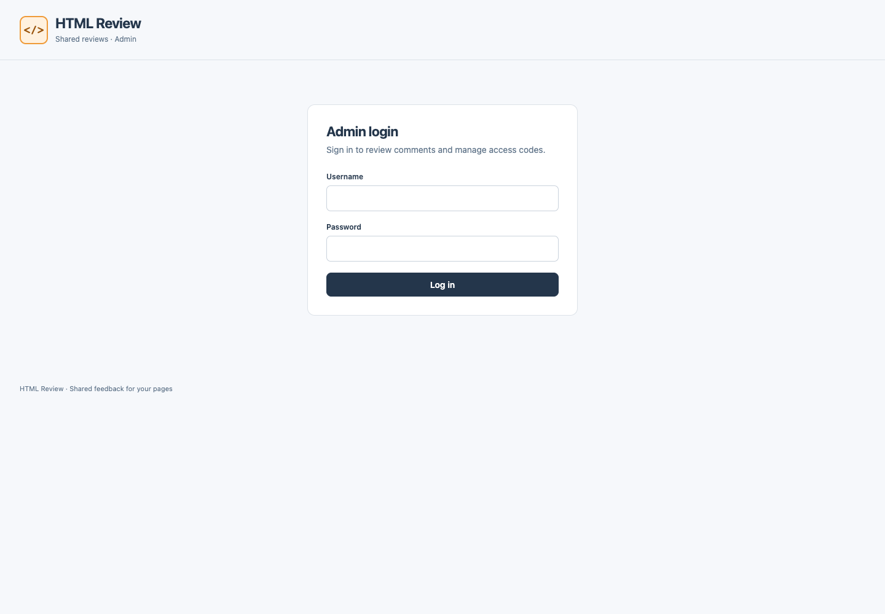
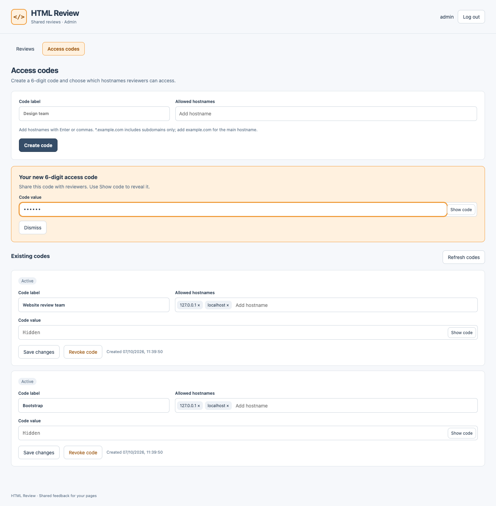
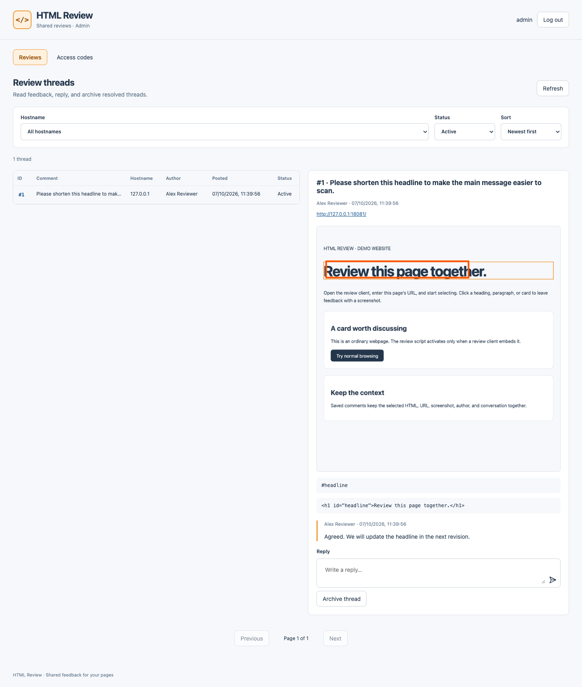
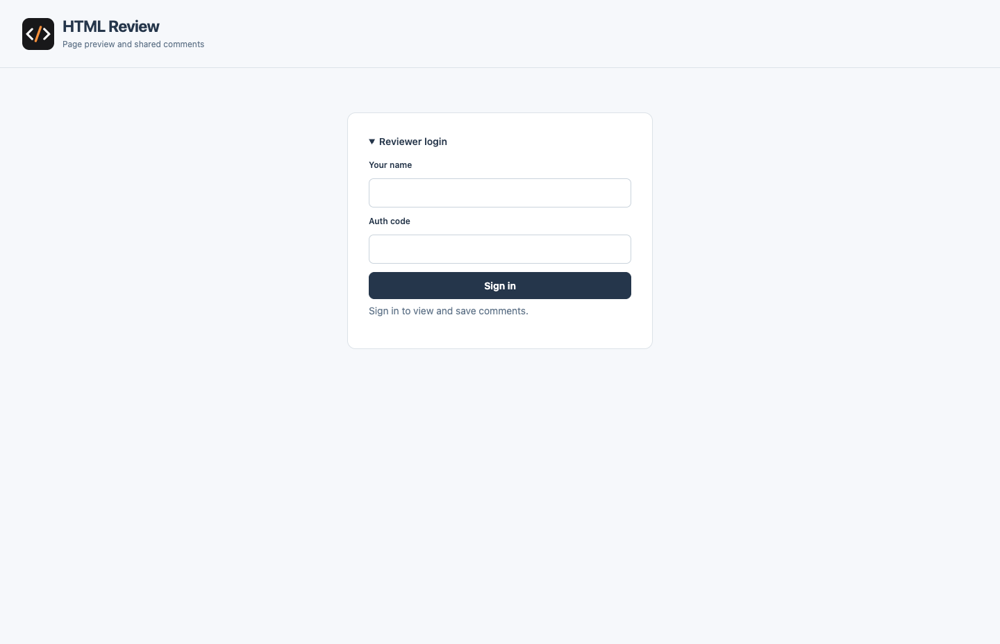
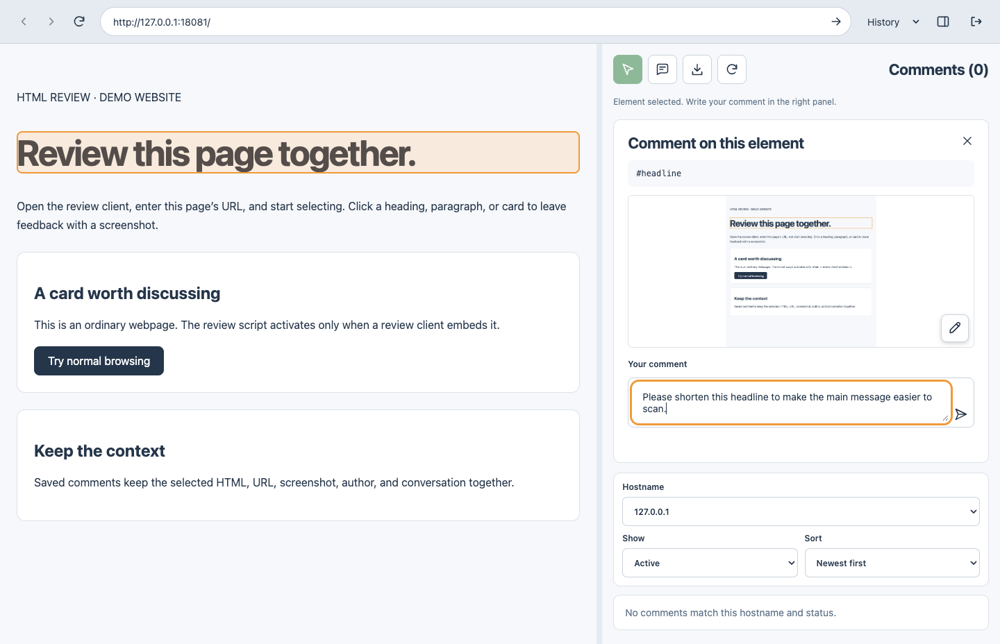
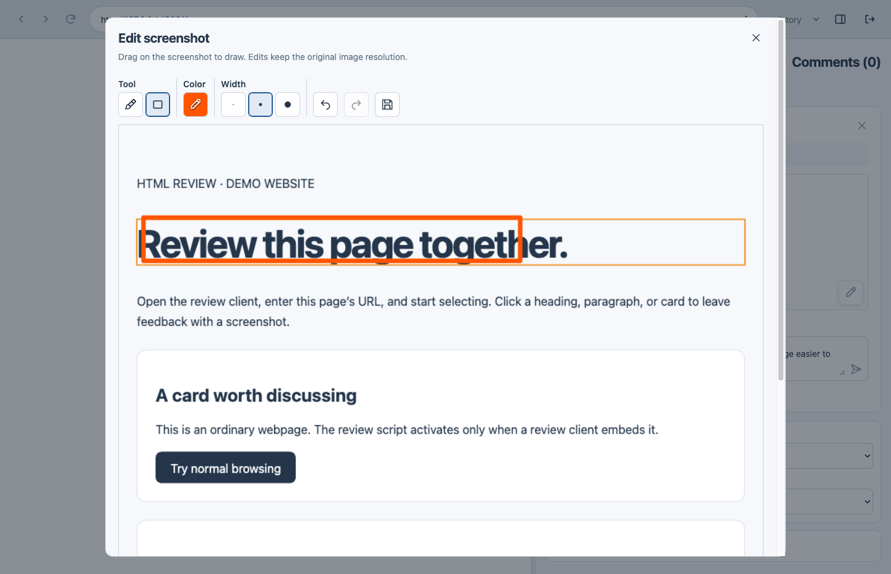
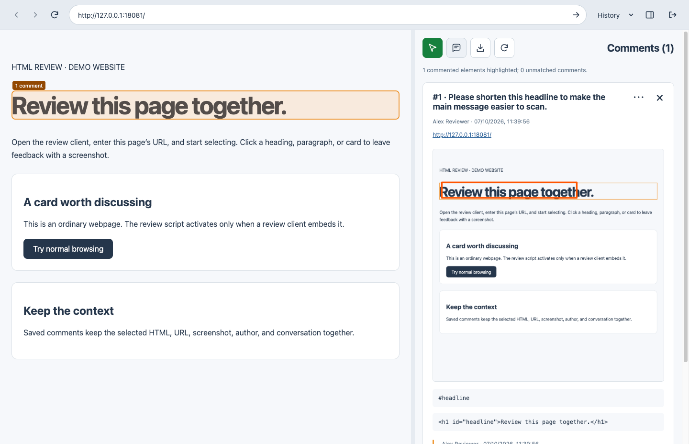
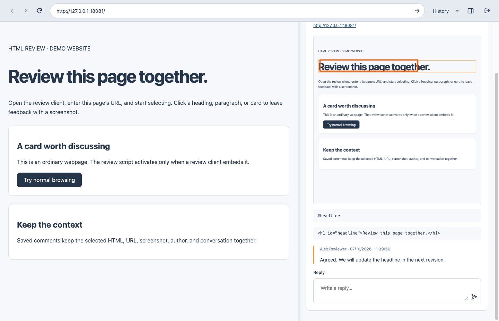
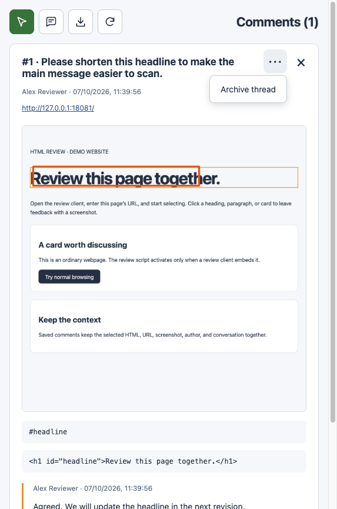

# HTML Review 使用指南

**更新日期：2026 年 10 月 13 日 · 版本 1.0.1**

使用**管理員控制台**管理審閱者的存取權限及跟進意見。使用 **Electron 桌面應用程式**瀏覽網站、選取網頁元素，並附上截圖提交留言。兩者連接同一個審閱伺服器，因此已儲存的討論串及回覆會同步顯示。

以下截圖使用獨立的本機示範環境及示例資料。桌面應用程式的概覽圖片按實際顯示位置合併網站區域及留言區域的截圖。`127.0.0.1` 網址僅供示範；日常使用時，請改用團隊的伺服器及網站網址。指南保留介面上的英文名稱，並附上中文說明，方便對照操作。

## 控制台及下載網址

| 資源 | 網址 |
| --- | --- |
| 管理員控制台 | [https://html-review-206149277907.asia-east1.run.app/](https://html-review-206149277907.asia-east1.run.app/) |
| Electron 桌面應用程式 — macOS Apple silicon，v1.0.1 DMG | [https://github.com/devtalkbox/tbproducts-html-review-release/releases/download/v1.0.1/HTML.Review-1.0.1-arm64.dmg](https://github.com/devtalkbox/tbproducts-html-review-release/releases/download/v1.0.1/HTML.Review-1.0.1-arm64.dmg) |
| 最新版本及可用下載檔案 | [https://github.com/devtalkbox/tbproducts-html-review-release/releases/latest](https://github.com/devtalkbox/tbproducts-html-review-release/releases/latest) |

下載檔案已公開，毋須 GitHub 帳戶。上述 DMG 適用於配備 Apple silicon（M 系列晶片）的 Mac；最新版本亦提供 Intel Mac、Windows 及 Linux 下載檔案。

## 開始前的準備

| 所需資料 | 管理員控制台 | Electron 應用程式 |
| --- | --- | --- |
| 審閱伺服器 | 團隊的審閱伺服器網址 | 同一個審閱伺服器網址 |
| 登入資料 | 管理員用戶名稱及密碼 | 你的顯示名稱及審閱者存取碼 |
| 網站存取權限 | 管理員可查看所有共用討論串 | 存取碼必須允許該網站的主機名稱 |

已部署的控制台位於 [HTML Review](https://html-review-206149277907.asia-east1.run.app/)。請向管理員索取登入資料或存取碼。你的顯示名稱會出現在留言及回覆上。

**一般流程：**管理員建立存取碼 → 審閱者開啟網站並提交意見 → 團隊回覆 → 問題解決後封存討論串。

## 使用管理員控制台

### 1. 登入

1. 在瀏覽器開啟審閱伺服器網址。
2. 輸入 **Username**（用戶名稱）及 **Password**（密碼）。
3. 按 **Log in**（登入）。控制台會開啟 **Reviews**（審閱）頁面。



管理員登入資料與審閱者存取碼是分開的。完成操作後，按右上角的 **Log out**（登出）。

### 2. 建立審閱者存取碼

1. 選擇 **Access codes**（存取碼）。
2. 在 **Code label**（存取碼標籤）輸入名稱，例如 `Website review team`（網站審閱團隊）。
3. 在 **Allowed hostnames**（允許的主機名稱）逐一輸入主機名稱，然後按 **Enter**；亦可用逗號分隔多個主機名稱。
4. 按 **Create code**（建立存取碼），產生六位數字存取碼。
5. 按 **Show code**（顯示存取碼），私下將存取碼分享給審閱者，再按 **Hide code**（隱藏存取碼）。**Dismiss**（關閉）會關閉新存取碼面板；存取碼仍會保留在 **Existing codes**（現有存取碼）下。



輸入主機名稱時，不要包含通訊協定（如 `https://`）、連接埠或路徑：

| 規則 | 允許的範圍 |
| --- | --- |
| `example.com` | 只允許 `example.com` |
| `*.example.com` | 允許 `www.example.com`、`staging.example.com` 等子網域；不包括 `example.com` 本身 |
| `example.com, *.example.com` | 允許主網域及其子網域 |

規則不會區分連接埠。請加入網站重新導向後使用的主機名稱；如網站使用獨立登入主機名稱，亦須按需要加入。

管理現有存取碼：

- 修改標籤或主機名稱標籤後，按 **Save changes**（儲存變更）。按主機名稱標籤上的 **×** 可移除該主機名稱。
- 按 **Show code** 或 **Hide code**，顯示或隱藏存取碼。
- **Revoke code**（撤銷存取碼）會取消使用該存取碼的審閱者的存取權限，包括已登入的工作階段。
- **Resume code**（恢復存取碼）可重新啟用已撤銷的存取碼。
- 已撤銷的存取碼會提供 **Delete code**（刪除存取碼）選項；確認後會永久刪除。

如果舊存取碼要求輸入原有值，請輸入一次原有存取碼，再按 **Show code**，以恢復顯示／隱藏功能。如果無人知道原有存取碼，請建立新的存取碼作替代。

### 3. 搜尋及閱讀意見

1. 選擇 **Reviews**（審閱）。
2. 在 **Hostname**（主機名稱）選擇網站，或保留 **All hostnames**（所有主機名稱）。
3. 在 **Status**（狀態）選擇 **Active**（未封存）、**Archived**（已封存）或 **All**（全部）。
4. 在 **Sort**（排序）選擇 **Newest first**（最新優先）、**Oldest first**（最舊優先）或 **Recent activity**（最近有更新）。
5. 選取討論串表格中的一行，在右側開啟詳細資料。



每個討論串均包含編號、留言、作者、網站網址、截圖、所選元素的詳細資料及回覆。按 **Refresh**（重新整理）查看最新意見，並使用 **Previous**（上一頁）／**Next**（下一頁）瀏覽結果頁面。

### 4. 回覆及封存

1. 開啟一個未封存的討論串。
2. 向下捲動詳細資料，找到 **Reply**（回覆）欄位。
3. 輸入回覆，然後按標示為 **Post reply**（提交回覆）的傳送箭嘴。
4. 問題解決後，按 **Archive thread**（封存討論串）。

已封存的討論串仍可在 **Status → Archived** 或 **All** 下查看。選取已封存的討論串，按 **Unarchive thread**（取消封存討論串）即可重新開啟。討論串封存期間不能新增回覆。

## 使用 Electron 桌面應用程式

### 1. 啟動應用程式

從[最新公開版本](https://github.com/devtalkbox/tbproducts-html-review-release/releases/latest)下載適合你作業系統的檔案。

| 平台 | 啟動方式 |
| --- | --- |
| macOS Apple silicon 或 Intel | 開啟相應的 DMG，將 **HTML Review** 拖曳至 **Applications**（應用程式），然後開啟。 |
| Windows x64 可攜式版本 | 按兩下 `HTML.Review.Portable.1.0.1-x64.exe`，毋須安裝；執行時會將所需檔案解壓至暫存資料夾。 |
| Windows x64 安裝程式 | 執行 `HTML.Review.Setup.1.0.1-x64.exe`，完成後開啟 **HTML Review**。 |
| Linux x64 | 按以下指令將 AppImage 設為可執行並啟動。 |

```sh
chmod +x HTML.Review-1.0.1-x64.AppImage
./HTML.Review-1.0.1-x64.AppImage
```

1.0.1 版本預設連接[已部署的審閱伺服器](https://html-review-206149277907.asia-east1.run.app/)，毋須安裝 Node.js、npm 或透過指令指定伺服器。請向管理員索取審閱者存取碼。應用程式與管理員控制台必須連接同一個伺服器。

macOS 套件使用 ad-hoc 簽署，未經 Apple 公證；Windows 套件沒有發行者憑證。作業系統可能顯示安全提示。Windows 及 Linux 版本尚未在各自的作業系統上測試。

如要連接其他伺服器，可於啟動時加入 `--server`，或設定 `REVIEW_SERVER_URL`。已安裝的 macOS 應用程式可使用：

```sh
open -a "HTML Review" --args --server https://YOUR_REVIEW_SERVER
```

Windows 可攜式版本可於 PowerShell 使用：

```powershell
.\HTML.Review.Portable.1.0.1-x64.exe --server https://YOUR_REVIEW_SERVER
```

伺服器網址必須使用 HTTPS；本機開發亦可使用 HTTP 回送位址（loopback）。網址不可包含帳戶資料、路徑、查詢參數或片段識別碼。套件及校驗碼詳情請參閱[下載及設定 README](../../README.md)。

### 2. 以審閱者身分登入

1. 在 **Your name**（你的名稱）輸入隊友能辨認的名稱。
2. 在 **Auth code**（驗證碼）輸入管理員提供的存取碼。
3. 按 **Sign in**（登入）。



重新啟動應用程式後，系統會保留審閱者登入狀態。登入工作階段會在 24 小時後到期；收到提示時，請重新登入。網站本身的登入是獨立的：如果被審閱的網站需要帳戶，請在應用程式內登入該網站。

### 3. 開啟網站

1. 在網址列輸入完整網站網址，例如 `https://staging.example.com`。
2. 按網址列末端標示為 **Open page**（開啟網頁）的箭嘴。
3. 等候網頁載入。左側會顯示網站，右側會顯示留言。


桌面應用程式會直接開啟網站；網站毋須安裝審閱程式碼，亦毋須允許透過 iframe 嵌入。

將滑鼠指標停留在圖示按鈕上，即可查看按鈕名稱：

| 位置 | 控制項 | 用途 |
| --- | --- | --- |
| 網址列 | Previous page / Next page（上一頁／下一頁） | 在應用程式內已開啟的網頁之間切換 |
| 網址列 | Refresh page（重新整理網頁） | 重新載入網站 |
| 網址列 | History（瀏覽記錄） | 重新開啟曾瀏覽的網址 |
| 網址列 | Hide comments / Show comments（隱藏／顯示留言） | 切換留言面板的顯示狀態 |
| 網址列 | Sign out（登出） | 結束審閱者登入工作階段 |
| 留言工具列 | 指標圖示 — Start selecting（開始選取） | 選取要留言的網頁元素 |
| 留言工具列 | 對話框圖示 — Highlight commented elements（標示已有留言的元素） | 標示目前網頁上有未封存留言的元素 |
| 留言工具列 | 下載箭嘴 — Export（匯出） | 下載 HTML 報告 |
| 留言工具列 | 圓形箭嘴 — Refresh（重新整理） | 重新載入留言清單 |

拖曳網站與留言之間的分隔線，可調整兩側面板的大小。

### 4. 選取元素並撰寫意見

1. 按留言工具列的 **Start selecting**（開始選取）。
2. 將滑鼠指標移至網站上，查看被標示的元素。
3. 按一下你想討論的元素。
4. 應用程式會擷取目前可見的網頁，並在右側開啟 **Comment on this element**（就此元素留言）面板。
5. 在 **Your comment**（你的留言）輸入清晰說明，例如「請縮短這個標題，讓讀者更容易掌握主要訊息。」



按 **Stop selecting**（停止選取）或 **Escape**，即可返回正常瀏覽模式。按草稿上標示為 **Cancel comment**（取消留言）的 **×** 可取消留言；如有未儲存的變更，須確認捨棄草稿。

### 5. 標註截圖並儲存

1. 提交前，按截圖上標示為 **Edit screenshot**（編輯截圖）的鉛筆圖示。
2. 選擇 **Brush**（畫筆）或 **Rectangle**（矩形），再選擇繪圖顏色及線條粗幼。
3. 在截圖上拖曳以繪製標註。使用 **Undo**（復原）或 **Redo**（重做）調整標註。
4. 按標示為 **Save screenshot**（儲存截圖）的磁碟圖示，套用修改。編輯器上標示為 **Cancel**（取消）的 **×** 會關閉編輯器，而不套用這次的修改。
5. 返回留言面板，按標示為 **Save comment**（儲存留言）的傳送箭嘴。
6. 等候 **Comment saved**（留言已儲存）訊息及已儲存的討論串出現。



**截圖提交後便不能修改，管理員亦不例外。**儲存前請檢查截圖及標註。截圖只涵蓋目前可見的網頁區域及主文件；元素選取不支援巢狀 iframe 或 Shadow DOM 根節點。部分跨來源圖片、影片或 CSS 效果在截圖中的顯示可能與網頁不同。

如果儲存失敗，請保留草稿並再次按 **Save comment**。如果網頁已變更，導致草稿失效，請取消草稿並重新選取元素。

### 6. 閱讀討論串及回覆

1. 使用 **Hostname**（主機名稱）、**Show**（顯示）及 **Sort**（排序）篩選留言清單。
2. 選取討論串，查看截圖、元素詳細資料及對話。
3. 捲動至 **Reply**（回覆），輸入回覆，再按 **Post reply**（提交回覆）。
4. 按右上角標示為 **Back to comments**（返回留言清單）的 **×**，返回清單。





按 **Highlight commented elements**（標示已有留言的元素），標示目前網頁上有未封存討論串的元素。在被標示的元素上按滑鼠右鍵，即可開啟相關討論串。如果建立討論串後網站結構已改變，系統可能無法再找到對應元素。

### 7. 封存或重新開啟討論串

1. 開啟討論串。
2. 按詳細資料面板右上角標示為 **Comment actions**（留言操作）的 **⋯**。
3. 意見已處理後，選擇 **Archive thread**（封存討論串）。



如要重新開啟討論串，將 **Show** 設為 **Archived**（已封存）或 **All**（全部），選取討論串，再選擇 **Comment actions → Unarchive thread**（取消封存討論串）。封存會保留截圖及對話，但在重新開啟前不能新增回覆。

### 8. 匯出 HTML 報告

1. 設定 **Hostname**、**Show** 及 **Sort** 篩選條件，選擇要包含的意見。
2. 按留言工具列的下載箭嘴 **Export**（匯出）。
3. 等候系統準備截圖，並顯示已匯出的留言數目。
4. 在瀏覽器開啟下載的 `html-review-YYYY-MM-DD.html` 檔案。

匯出會包含所有符合篩選條件的結果頁面，以及截圖和回覆。如要包含已處理的意見，請在匯出前選擇 **Show → All**。報告包含審閱內容及截圖，請只與指定收件人分享。

## 疑難排解

| 問題 | 處理方法 |
| --- | --- |
| 無法登入控制台 | 向管理員核對伺服器網址、管理員用戶名稱及密碼。審閱者存取碼不能用作管理員登入。 |
| 審閱者存取碼被拒絕 | 向管理員核對存取碼及伺服器網址。存取碼可能已被撤銷。 |
| 主機名稱未獲授權 | 請管理員將確切的主機名稱加入你的存取碼，包括重新導向或登入使用的主機名稱。修改後重新開啟網頁。 |
| Start selecting 無法使用 | 等候網站載入，查看狀態訊息，再按 Open page 重試。 |
| 截圖擷取失敗 | 按 Retry capture（重新擷取），或選取其他元素。 |
| 草稿提示網頁已變更 | 取消已失效的草稿，在目前網頁重新選取元素。 |
| 留言或回覆無法儲存 | 保留草稿，檢查網絡連線後重試。 |
| 找不到討論串 | 檢查 Hostname 及 Active / Archived / All 篩選條件，再重新整理。 |
| 無法回覆 | 檢查討論串是否已封存。取消封存後即可繼續討論。 |
| 應用程式要求重新登入 | 登入工作階段可能已到期，或存取碼已被撤銷。請重新登入或聯絡管理員。 |
| 網站畫面中斷連線或當機 | 按 Open page，重新載入網站並恢復連線。 |
